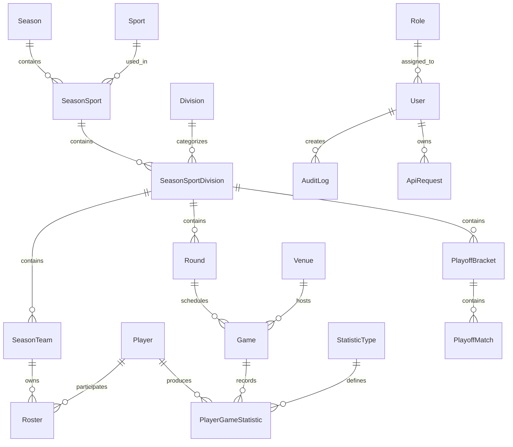

# Entity Relationship Diagram (ERD)

## Overview

This document defines the entities, relationships, cardinalities, constraints, and persistence rules of the League Management System.

The database design follows the business requirements defined in previous documents.

---

# Entity List

## Core League Entities

- Season
- Sport
- Division
- SeasonSport
- SeasonSportDivision

## Team Management

- SeasonTeam
- Roster
- Player
- VoterRegistration

## Competition Management

- Round
- Game
- Venue

## Statistics

- StatisticType
- PlayerGameStatistic

## Playoffs

- PlayoffBracket
- PlayoffMatch

## Security

- User
- Role

## System

- AuditLog
- ApiRequest
- SystemSetting

---

# Relationship Summary

| Parent | Child | Relationship |
|---------|-------|-------------|
| Season | SeasonSport | One-to-Many |
| Sport | SeasonSport | One-to-Many |
| SeasonSport | SeasonSportDivision | One-to-Many |
| Division | SeasonSportDivision | One-to-Many |
| SeasonSportDivision | SeasonTeam | One-to-Many |
| Player | Roster | One-to-Many |
| SeasonTeam | Roster | One-to-Many |
| Round | Game | One-to-Many |
| Venue | Game | One-to-Many |
| SeasonTeam | Game | One-to-Many (Team A) |
| SeasonTeam | Game | One-to-Many (Team B) |
| Game | PlayerGameStatistic | One-to-Many |
| Player | PlayerGameStatistic | One-to-Many |
| StatisticType | PlayerGameStatistic | One-to-Many |
| SeasonSportDivision | PlayoffBracket | One-to-Many |
| PlayoffBracket | PlayoffMatch | One-to-Many |
| SeasonTeam | PlayoffMatch | One-to-Many |
| Role | User | One-to-Many |
| User | AuditLog | One-to-Many |
| User | ApiRequest | One-to-Many |

---

# Cardinality Rules

## Season → SeasonSport

One Season may contain many Sports.

Example:

```text
2026 Summer League
    ├── Basketball
    └── Volleyball
```

Cardinality:

```text
Season 1 ─── N SeasonSport
```

---

## Sport → SeasonSport

One Sport may appear in many Seasons.

Example:

```text
Basketball
    ├── 2025
    ├── 2026
    └── 2027
```

Cardinality:

```text
Sport 1 ─── N SeasonSport
```

---

## SeasonSport → SeasonSportDivision

One Sport within a Season may contain multiple divisions.

Example:

```text
Basketball
    ├── Junior
    └── Senior
```

Cardinality:

```text
SeasonSport 1 ─── N SeasonSportDivision
```

---

## SeasonSportDivision → SeasonTeam

One division contains many participating teams.

Cardinality:

```text
SeasonSportDivision 1 ─── N SeasonTeam
```

---

## SeasonTeam → Roster

A team contains many roster entries.

Cardinality:

```text
SeasonTeam 1 ─── N Roster
```

---

## Player → Roster

A Player may participate in many seasons.

Cardinality:

```text
Player 1 ─── N Roster
```

Business Rule:

```text
A Player may belong to only one team
per Sport per Season.
```

---

## Round → Game

One Round contains many Games.

Cardinality:

```text
Round 1 ─── N Game
```

---

## Venue → Game

One Venue hosts many Games.

Cardinality:

```text
Venue 1 ─── N Game
```

---

## Game → PlayerGameStatistic

One Game contains many Player Statistics.

Cardinality:

```text
Game 1 ─── N PlayerGameStatistic
```

---

## StatisticType → PlayerGameStatistic

One Statistic Type may appear many times.

Examples:

```text
Points
Rebounds
Kills
Assists
```

Cardinality:

```text
StatisticType 1 ─── N PlayerGameStatistic
```

---

## SeasonSportDivision → PlayoffBracket

One Division may have one or many playoff brackets.

Cardinality:

```text
SeasonSportDivision 1 ─── N PlayoffBracket
```

---

## PlayoffBracket → PlayoffMatch

One Bracket contains many Matches.

Cardinality:

```text
PlayoffBracket 1 ─── N PlayoffMatch
```

---

## Role → User

One Role may belong to many Users.

Cardinality:

```text
Role 1 ─── N User
```

Business Rule:

```text
Each User has exactly one Role.
```

---

# Unique Constraints

## Season

```text
(name)
```

---

## Sport

```text
(name)
```

---

## Division

```text
(name)
```

---

## SeasonSport

```text
(season_id, sport_id)
```

---

## SeasonSportDivision

```text
(season_sport_id, division_id)
```

---

## SeasonTeam

```text
(season_sport_division_id, team_name)
```

---

## Player

```text
(first_name, middle_name, last_name, birthdate)
```

---

## Roster

```text
(player_id, season_sport_division_id)
```

Ensures:

```text
One player per sport per season.
```

---

## User

```text
(username)
(email)
```

---

## Role

```text
(name)
```

---

## StatisticType

```text
(code)
```

Examples:

```text
PTS
REB
AST
KILL
BLOCK
```

---

## PlayerGameStatistic

```text
(game_id, player_id, statistic_type_id)
```

---

## ApiRequest

```text
(idempotency_key)
```

---

# Foreign Keys

| Table | Foreign Key |
|--------|-------------|
| SeasonSport | season_id |
| SeasonSport | sport_id |
| SeasonSportDivision | season_sport_id |
| SeasonSportDivision | division_id |
| SeasonTeam | season_sport_division_id |
| Roster | season_team_id |
| Roster | player_id |
| VoterRegistration | player_id |
| Round | season_sport_division_id |
| Game | round_id |
| Game | venue_id |
| Game | home_team_id |
| Game | away_team_id |
| PlayerGameStatistic | game_id |
| PlayerGameStatistic | player_id |
| PlayerGameStatistic | statistic_type_id |
| PlayoffBracket | season_sport_division_id |
| PlayoffMatch | playoff_bracket_id |
| PlayoffMatch | team1_id |
| PlayoffMatch | team2_id |
| User | role_id |
| AuditLog | user_id |
| ApiRequest | user_id |

---

# Cascade Strategy

## Parent Deletion Policy

Physical deletion shall not be performed in production.

The system shall use:

```text
Soft Delete / Archive
```

for historical preservation.

---

## Cascade Rules

```text
Season
    NO CASCADE DELETE

SeasonTeam
    NO CASCADE DELETE

Player
    NO CASCADE DELETE

Game
    NO CASCADE DELETE
```

Historical data must remain permanently available.

---

# Mermaid ER Diagram



---

# Future Enhancements (Excluded from V1)

The following features are intentionally excluded:

- Player Photos
- Team Logos
- Season Banners

Future versions may introduce:

```text
Media
```

entity for generic file management.