# Barangay League System: Current Feature Flowcharts

Reviewed against the code on 2026-11-16. These diagrams describe the **current
implementation**, not the complete planned Version 1 design. Solid arrows
represent existing behavior; planned features are listed separately at the end.
They are a guide to reading and extending the code, not a substitute for tests.

The diagrams below use Mermaid. GitHub renders Mermaid blocks; in VS Code, use
a Markdown preview with Mermaid support. A diamond is a decision, a rectangle
is an action, and an arrow shows the next step.

## PlantUML flowcharts for VS Code

Install the PlantUML extension for VS Code if needed, then open a `.puml` file
below and use **Preview Current Diagram** (usually `Alt+D`). Configure the
extension to render **locally** with Java and, when needed, Graphviz; do not use
a remote rendering server for private project files. Each diagram stands alone.
The descriptions and code links in this guide explain the rules and limitations
in more detail.

| PlantUML diagram | Guide |
| --- | --- |
| [01 System overview](flowcharts/01-system-overview.puml) | [System overview](#1-system-overview) |
| [02 Request layers](flowcharts/02-request-layers.puml) | [Request flow](#2-how-a-request-travels-through-the-code) |
| [03 Login and authorization](flowcharts/03-login-and-authorization.puml) | [Login and protected actions](#login-and-protected-actions) |
| [04 Create a user](flowcharts/04-create-user.puml) | [Create a user](#create-a-user) |
| [05 Season lifecycle](flowcharts/05-season-lifecycle.puml) | [Creation and status transitions](#creation-and-status-transitions) |
| [06 Ongoing readiness](flowcharts/06-ongoing-readiness.puml) | [Before moving to Ongoing](#before-moving-to-ongoing) |
| [07 Catalogs](flowcharts/07-catalogs.puml) | [Sport and division catalogs](#5-sport-and-division-catalogs) |
| [08 Season assignments](flowcharts/08-season-assignments.puml) | [Assign sports and divisions](#6-assign-sports-and-divisions-to-a-season) |
| [09 Team registration](flowcharts/09-team-registration.puml) | [Register and edit](#register-and-edit) |
| [10 Team archive and restore](flowcharts/10-team-archive-restore.puml) | [Archive and restore](#archive-and-restore) |
| [11 Player profiles](flowcharts/11-player-profiles.puml) | [Player profile management](#8-player-profile-management) |
| [12 Available players](flowcharts/12-available-players.puml) | [Available-player picker](#9-available-player-picker) |
| [13 Add a roster player](flowcharts/13-add-roster-player.puml) | [Add a player to a roster](#10-add-a-player-to-a-roster) |
| [14 Edit or remove a roster entry](flowcharts/14-edit-remove-roster.puml) | [Edit or remove a roster entry](#11-edit-or-remove-a-roster-entry) |
| [15 Schedule a game](flowcharts/15-schedule-game.puml) | [Schedule a game](#12-schedule-a-game) |
| [16 Reschedule a game](flowcharts/16-reschedule-game.puml) | [Reschedule a game](#13-reschedule-a-game) |
| [17 Frontend query cache](flowcharts/17-frontend-query-cache.puml) | [Frontend selection and query cache](#14-frontend-selection-and-query-cache) |
| [18 Data relationships](flowcharts/18-data-relationships.puml) | [Main data relationships](#15-main-data-relationships) |
| [19 Planned features (not implemented)](flowcharts/19-planned-features.puml) | [Planned features and known boundaries](#17-planned-features-and-known-boundaries) |

## 1. System overview

This is a typical administrator workflow, not a claim that every arrow is an
enforced prerequisite. Public visitors can read the season, catalog, team,
roster, and game lists without logging in.

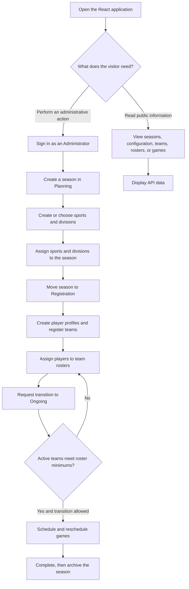

**Important:** The current Ongoing check does not require the season to have at
least one team. If there are active teams, each must meet its division minimum.
Player profiles can also be created independently of this sequence.

## 2. How a request travels through the code

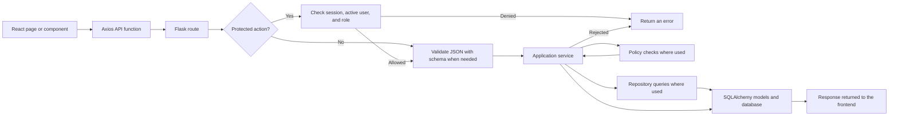

This is a map of responsibilities, not a claim that every request uses every
box. The implemented feature services use policies and repositories for their
applicable rules and queries. Services still coordinate checks, model changes,
and transactions; not every request needs each layer.

## 3. Login, authorization, and user creation

### Login and protected actions

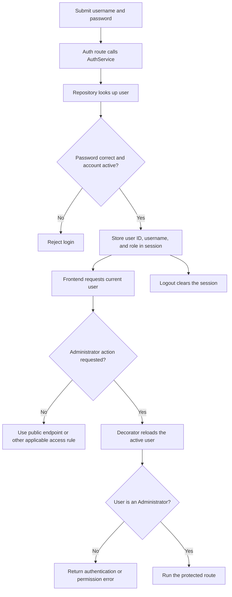

Administrator, Encoder, and Viewer are supported roles. The currently
implemented management mutations use administrator checks; game results and
statistics entry are **not implemented**. Public roster listings include player
data, while the player-profile management endpoints require an Administrator.

### Create a user

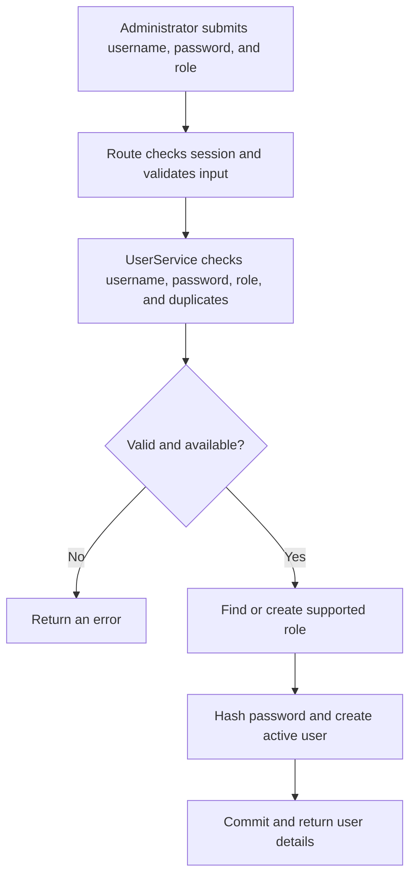

The system does not yet provide user listing, password reset, or a supported
first-administrator bootstrap.

## 4. Season creation and lifecycle

### Creation and status transitions

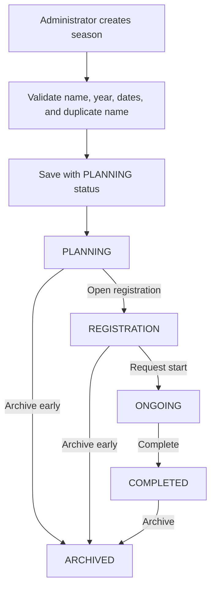

Only the shown transitions are supported. Opening Registration or moving to
Ongoing checks whether another season is already in Registration or Ongoing.
That check is application-level and is **not safe against all concurrent
activation requests**.

### Before moving to Ongoing

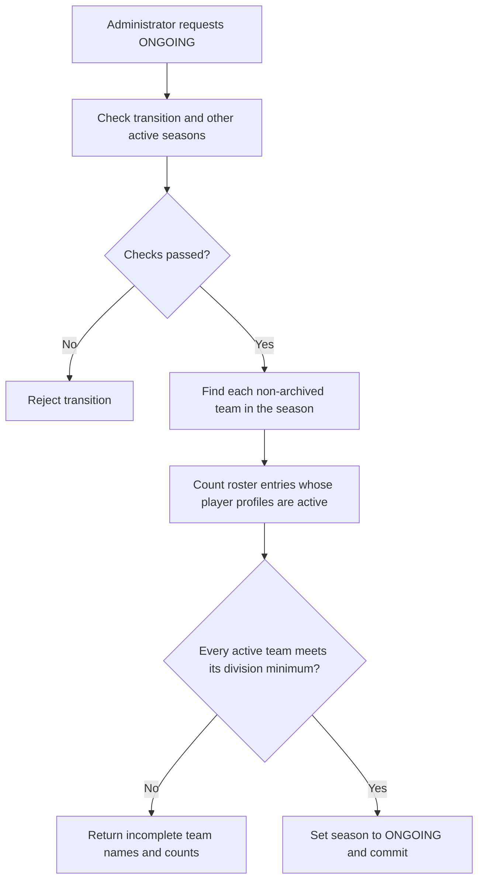

Archived teams and archived player profiles are excluded from this readiness
count. There is currently no explicit minimum-team requirement.

## 5. Sport and division catalogs

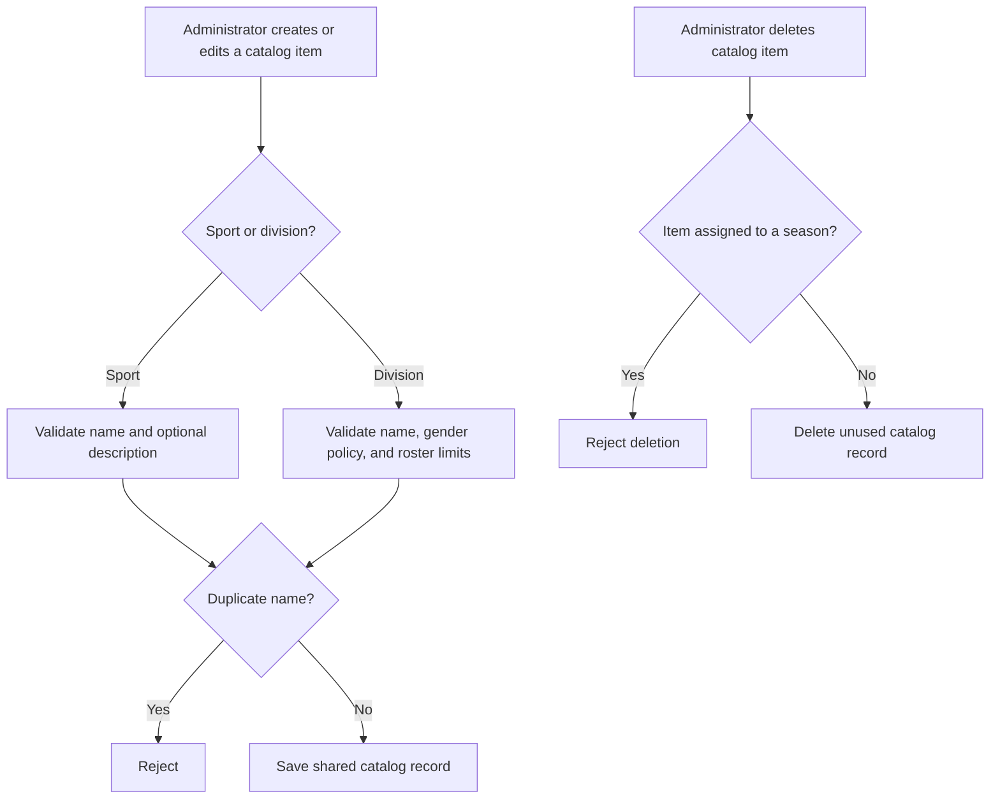

Catalog records are shared. Editing a catalog item can change what existing
season configurations display. Division gender policy is stored, but gender
eligibility is not yet enforced when adding players.

## 6. Assign sports and divisions to a season

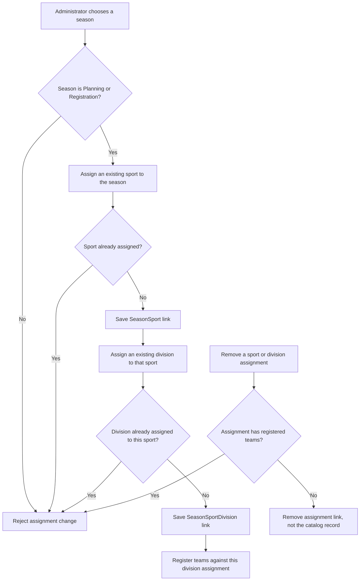

The removal check includes teams associated with the assignment; it is not
limited to active teams. Removing a sport link also removes its division links
when none of them has teams.

## 7. Team registration and management

### Register and edit

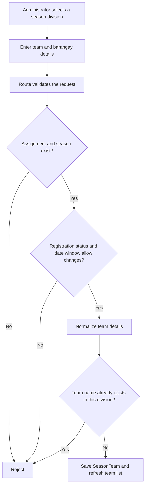

The registration window is inclusive when both dates are set; when both are
empty, Registration status alone controls the window. Editing additionally
requires the team not to be archived. Name checks include archived teams.

### Archive and restore

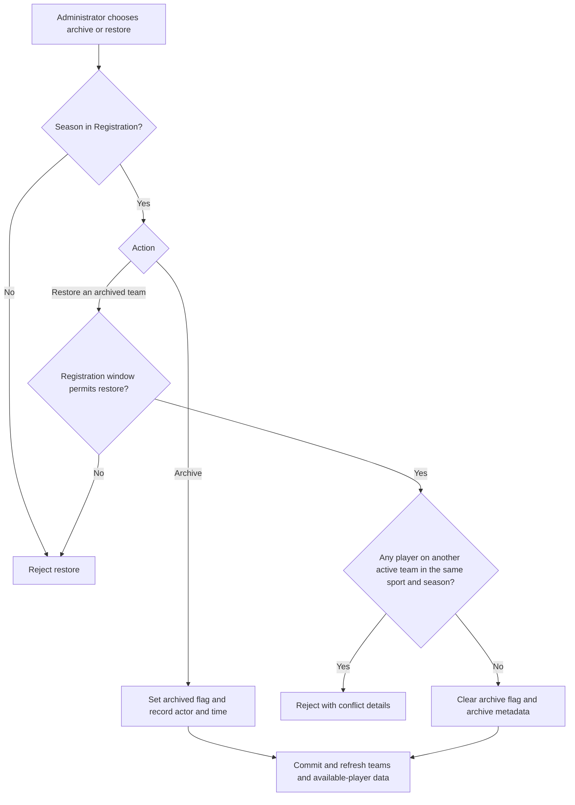

Archiving is allowed throughout Registration, even outside the date window.
Restoring requires the window to be open when dates are configured. A conflict
returns HTTP 409 with the player and other team; remove the player from the
other team before restoring. Roster additions and archive/restore operations
share a season-sport lock during their checks and writes.

## 8. Player profile management

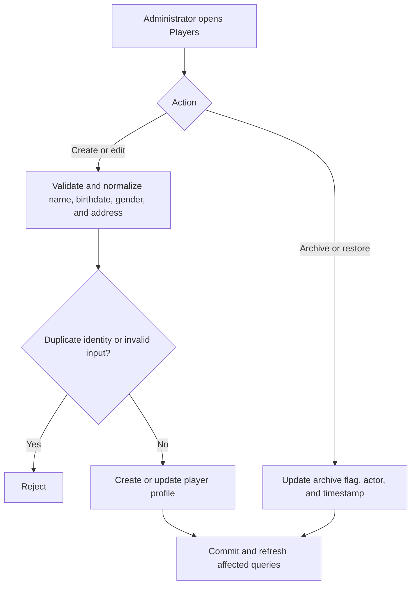

The duplicate check uses first, middle and last name plus birthdate. An archived
profile must be restored before it can be edited. Archiving preserves roster
links; an archived player is excluded from active roster readiness and the
available-player list.

## 9. Available-player picker

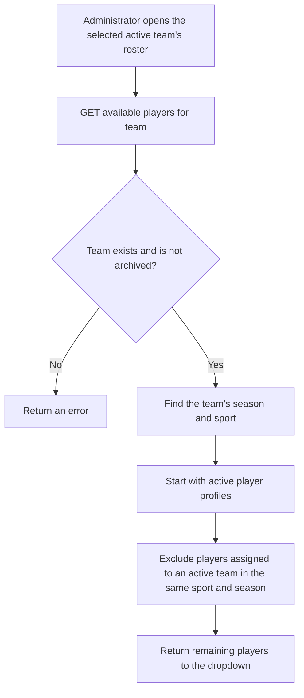

An assignment in another sport or season does not block the player. A roster
link to an archived team does not block availability. The dropdown is only a
convenience: the add-player service checks the rules again on submission.

## 10. Add a player to a roster

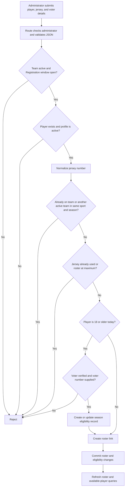

Adult verification is entered by the administrator; there is no independent
voter-registration lookup. The service requires the verification checkbox and
number on each adult add request, even if an eligibility record already exists.
Age and registration-window checks use the server's current date.
The [roster service](../../backend/app/application/rosters/services.py) obtains
records and coordinates persistence, while the
[roster policy](../../backend/app/application/rosters/policies.py) validates
player, team, conflict, capacity, and voter requirements. The
[team policy](../../backend/app/application/teams/policies.py) checks the
registration window. The [roster repository](../../backend/app/infrastructure/database/roster_repository.py)
handles ORM changes and supplies typed data to the service. Its
[transaction wrapper](../../backend/app/infrastructure/database/unit_of_work.py)
commits both writes together or rolls them back on failure.

## 11. Edit or remove a roster entry

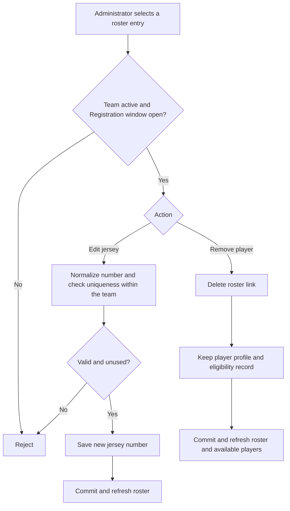

## 12. Schedule a game

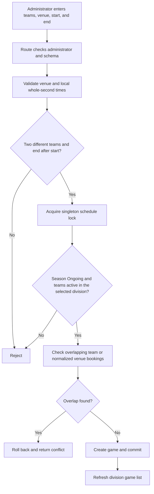

Times are stored as local datetimes without a timezone offset or fractional
seconds. Venue comparison normalizes whitespace and case. Adjacent intervals
are allowed. The venue check applies across all games, including games in other
divisions or seasons. Current game creation does **not** require a future start.

## 13. Reschedule a game

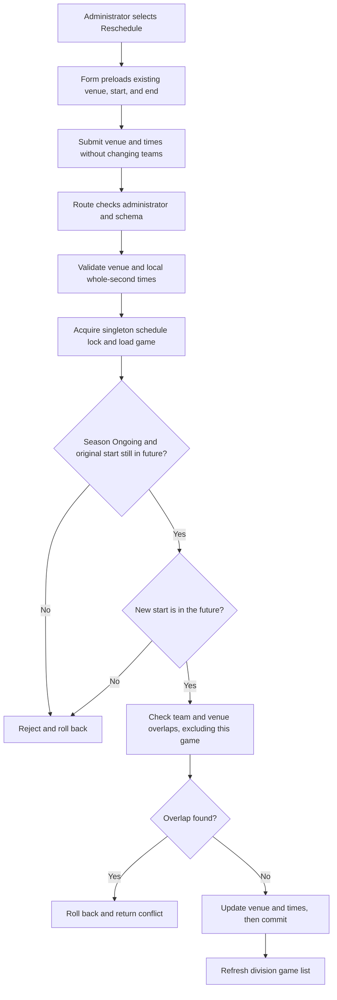

Both future-time checks use the **server's local clock**. They do not convert
between timezones, so deployments must account for the server and users'
expected local time. Rescheduling retains the existing teams; it does not
revalidate their current archive status.

## 14. Frontend selection and query cache

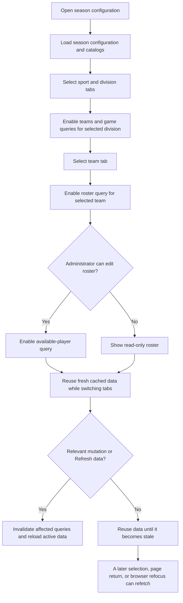

Season-page data has a one-minute freshness period. Expiry itself is not a
polling timer: updates made elsewhere are not pushed live. **Refresh data**
checks immediately; a browser reload starts a new in-memory cache. Hidden tab
panels stay mounted to preserve drafts, but their queries are disabled.

## 15. Main data relationships

This is a learning map, not a complete entity-relationship diagram.

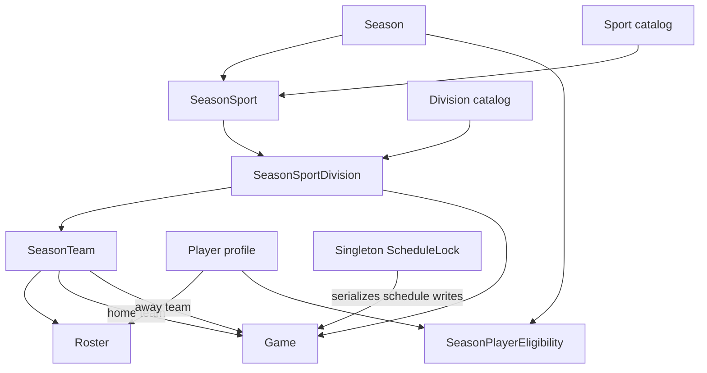

Removing a roster entry deletes the team-player link, not the player profile.
Eligibility is stored separately for a player and season.

## 16. Where to read and build each feature

All paths below are links to the current source, not proposed files.

| Feature | Route | Service and rules | Storage / tests |
| --- | --- | --- | --- |
| Authentication | [Auth routes](../../backend/app/api/v1/auth/routes.py) | [Auth service](../../backend/app/application/auth/services.py), [auth policy](../../backend/app/application/auth/policies.py), [authorization decorator](../../backend/app/application/common/decorators/authorization.py) | [User repository](../../backend/app/infrastructure/database/user_repository.py) |
| User creation | [User routes](../../backend/app/api/v1/users/routes.py) | [User service](../../backend/app/application/users/services.py) | [User model](../../backend/app/domain/models/users.py) |
| Seasons | [Season routes](../../backend/app/api/v1/seasons/routes.py) | [Season service](../../backend/app/application/season/services.py), [season policy](../../backend/app/application/season/policies.py) | [Season repository](../../backend/app/infrastructure/database/season_repository.py) |
| Catalogs and assignments | [Catalog routes](../../backend/app/api/v1/catalogs/routes.py), [season routes](../../backend/app/api/v1/seasons/routes.py) | [Catalog service](../../backend/app/application/catalogs/services.py), [catalog policy](../../backend/app/application/catalogs/policies.py) | [Catalog repository](../../backend/app/infrastructure/database/catalog_repository.py) |
| Teams | [Team routes](../../backend/app/api/v1/teams/routes.py) | [Team service](../../backend/app/application/teams/services.py), [team policy](../../backend/app/application/teams/policies.py) | [Team repository](../../backend/app/infrastructure/database/season_team_repository.py) |
| Players | [Player routes](../../backend/app/api/v1/players/routes.py) | [Player service](../../backend/app/application/players/services.py), [player policy](../../backend/app/application/players/policies.py) | [Player repository](../../backend/app/infrastructure/database/player_repository.py) |
| Rosters | [Team and roster routes](../../backend/app/api/v1/teams/routes.py) | [Roster service](../../backend/app/application/rosters/services.py), [roster policy](../../backend/app/application/rosters/policies.py), [team policy](../../backend/app/application/teams/policies.py) | [Roster repository](../../backend/app/infrastructure/database/roster_repository.py), [roster tests](../../backend/tests/test_players_rosters_api.py) |
| Games | [Game routes](../../backend/app/api/v1/games/routes.py), [game schemas](../../backend/app/schemas/game_schema.py) | [Game service](../../backend/app/application/games/services.py), [game policy](../../backend/app/application/games/policies.py) | [Game repository](../../backend/app/infrastructure/database/game_repository.py), [game model](../../backend/app/domain/models/games.py), [game tests](../../backend/tests/test_games_api.py) |
| Frontend | [Application routes](../../frontend/src/App.tsx) | [Season configuration](../../frontend/src/features/seasons/SeasonConfigurationPage.tsx), [team section](../../frontend/src/features/seasons/SeasonTeamsSection.tsx), [roster section](../../frontend/src/features/seasons/TeamRosterSection.tsx), [schedule section](../../frontend/src/features/seasons/DivisionScheduleSection.tsx) | [Season API client](../../frontend/src/shared/api/seasons.ts), [tab component](../../frontend/src/shared/components/SelectionTabs.tsx) |

### Suggested way to implement a new feature

1. Write down the actor, inputs, allowed states, failure cases, and expected
   result. Decide unresolved rules before coding.
2. Add focused tests for a successful request and important rejected cases.
3. Add or change the model and a **new** migration only if persistence changes.
4. Implement validation and business logic in the existing appropriate layer.
   Use policies for business rules and repositories for queries; keep
   orchestration and transaction boundaries in the service.
5. Add the schema and route, including authorization and explicit errors.
6. Connect the API client and UI; invalidate the relevant cached queries.
7. Run the focused tests and frontend build, then trace a real request through
   each layer. Do not edit an already-applied migration.

## 17. Planned features and known boundaries

These are **not implemented flows**. Their rules still need decisions and tests:

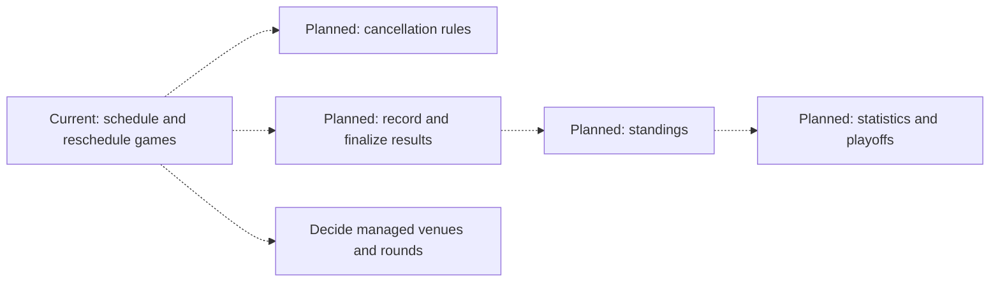

Other known gaps include a clean-database migration and first-administrator
bootstrap, stronger concurrent active-season enforcement, division eligibility
rules, and repository cleanup before publishing. See the [project roadmap](../checklist.md)
and [implementation alignment tracker](../backend/implementation-alignment.md).
